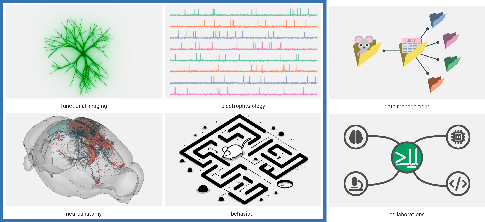
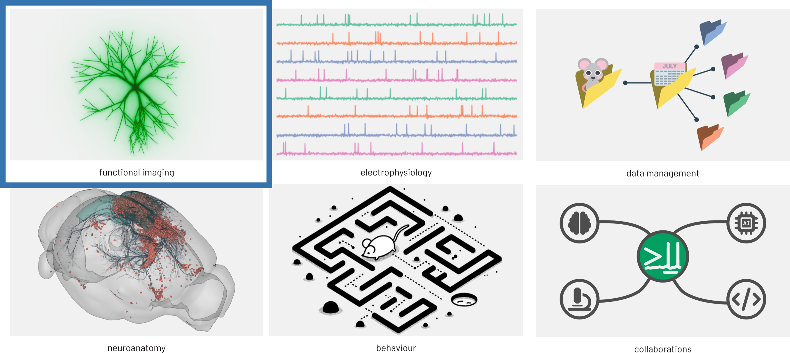

## Neuroinformatics Unit (NIU)

{height=5in}

::: {.notes}
I am Alessandro, this is Igor. We are part of the Neuroinformatics Unit based here at the Sainsbury Wellcome Centre and the Gatsby Unit. The Neuroinformatics Unit is a Research Software Engineering team, we make open-source software tools to analyse all kinds of systems neuroscience data, as well as for data management and for software development itself, and we're very collaborative.
:::

::: {.footer}
[https://neuroinformatics.dev](https://neuroinformatics.dev)
:::

## Functional imaging analysis 

{height=5in}

::: {.notes}
So Igor and I like working with imaging data, and so we are lucky to be able to work on imaging-related software. We both work on our neuroanatomy tools, which include BrainGlobe, which you may have heard about, and we both also work with functional imaging data. We have close ties to the microscopy facility here, and Igor is actually shared between the NIU and the facility. He will talk to you about the functional imaging work he is doing with them later on. What I am going to focus on today is something called "photon-mosaic", which is a collection of software tools to analyse functional imaging data in systems neuroscience.
:::

## References {.smaller}

This is how you create a references section, i.e. a bibliography.

::: {#refs}
:::
